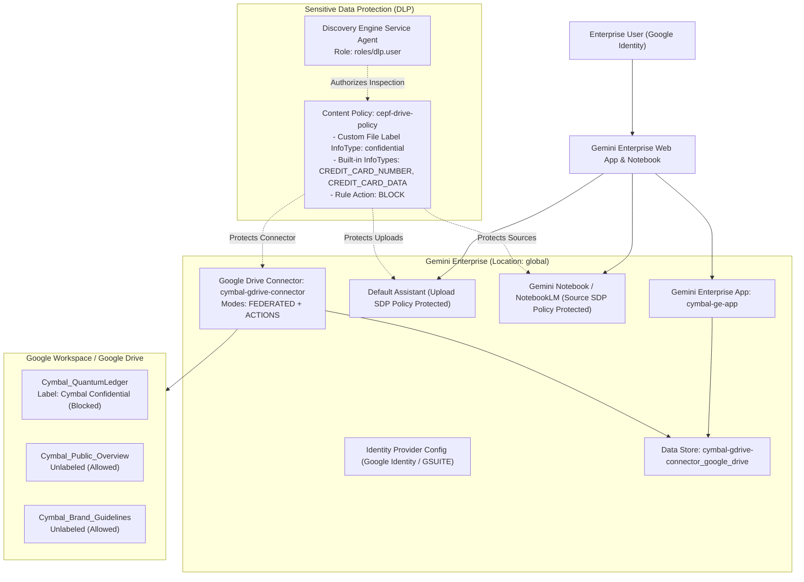

# FDE: Add Google Drive with Sensitive Data Protection to Gemini Enterprise — Challenge Lab

[](https://cloud.google.com/gemini/enterprise/docs)
[-34A853?logo=googlecloud&logoColor=white)](https://cloud.google.com/sensitive-data-protection/docs)
[](https://docs.cloud.google.com/gemini/enterprise/docs/connectors/gdrive)

Comprehensive step-by-step guide, operational runbook, and end-to-end CLI/API automation scripts for the **FDE: Add Google Drive with Sensitive Data Protection to Gemini Enterprise** Challenge Lab.

---

## Architecture & Workflow Overview



---

## Scenario & Objectives

**Cymbal Group**, a multinational services company, is rolling out **Gemini Enterprise** to improve knowledge discovery, operational efficiency, and cross-platform collaboration while enforcing strict security controls with **Sensitive Data Protection (SDP)**.

### Lab Tasks Summary

| Task | Objective | Key Resources / Parameters |
| :--- | :--- | :--- |
| **Task 1** | Configure the Gemini Enterprise app & authentication | App ID: `cymbal-ge-app`<br>Company: `Cymbal Group`<br>Location: `global`<br>IdP: `Google Identity` (`GSUITE`) |
| **Task 2** | Set up a Google Drive connector (Federated Search + Actions) | Data source: `google_drive`<br>Connector: `cymbal-gdrive-connector`<br>Modes: `FEDERATED`, `ACTIONS` (All actions enabled) |
| **Task 3** | Connect data store, add sample Google Docs, and validate | Data store: `cymbal-gdrive-connector_google_drive`<br>Docs: `Cymbal_QuantumLedger`, `Cymbal_Public_Overview`, `Cymbal_Brand_Guidelines` |
| **Task 4** | Label confidential doc & create custom SDP content policy | Label ID: `OiQWm4osiQYvIPl6oW6sZqALpOoNtv8zCP7RNNEbbFcb`<br>Policy: `cepf-drive-policy` (`global`)<br>Custom InfoType: `confidential` (`VERY_LIKELY`)<br>Built-in InfoTypes: `CREDIT_CARD_NUMBER`, `CREDIT_CARD_DATA`<br>Action: `BLOCK` |
| **Task 5** | Attach SDP policy to Google Drive connector & grant IAM role | Role: `roles/dlp.user` on `service-<PROJECT_NUMBER>@gcp-sa-discoveryengine.iam.gserviceaccount.com`<br>Attach `cepf-drive-policy` to `cymbal-gdrive-connector` |
| **Task 6** | Apply SDP policy to Assistant and Gemini Notebook | Attach `cepf-drive-policy` to `default_assistant` and `notebooklmConfig`<br>Validate blocked file uploads & pasted credit card text |

---

## Repository Structure

```text
.
├── README.md                           # Project overview, architecture, and quickstart
├── RUNBOOK.md                          # Detailed step-by-step UI + REST API/CLI Runbook (Tasks 1-6)
├── scripts/
│   ├── automate_lab.sh                 # End-to-end automated execution script for Tasks 1-6
│   └── verify_lab.sh                   # Verification script to check all resources and policies
└── sample-data/
    ├── Cymbal_QuantumLedger.txt        # Confidential financial overview sample document
    ├── Cymbal_Public_Overview.txt      # Public company overview sample document
    ├── Cymbal_Brand_Guidelines.txt     # Brand guidelines sample document
    └── credit_card_sample.txt          # Credit card test payload for Gemini Notebook SDP validation
```

---

## Quick Start (Automated Execution)

You can execute the entire lab automatically from **Google Cloud Shell** (logged in with your Qwiklabs student account so that your `gcloud` token includes both Google Cloud and Google Drive scopes):

```bash
# 1. Clone this repository
git clone https://github.com/Krishmp1112/FDE-Add-Google-Drive-with-Sensitive-Data-Protection-to-Gemini-Enterprise-Challenge-Lab.git
cd FDE-Add-Google-Drive-with-Sensitive-Data-Protection-to-Gemini-Enterprise-Challenge-Lab

# 2. Run the automated setup script (optionally pass the Drive Label ID if different in your lab session)
chmod +x scripts/automate_lab.sh scripts/verify_lab.sh
./scripts/automate_lab.sh "OiQWm4osiQYvIPl6oW6sZqALpOoNtv8zCP7RNNEbbFcb"

# 3. Verify all configurations
./scripts/verify_lab.sh
```

---

## Detailed Step-by-Step Guide & Runbook

For complete step-by-step instructions covering both the **Google Cloud Console UI** and **REST API / CLI commands**, see **[RUNBOOK.md](./RUNBOOK.md)**.
